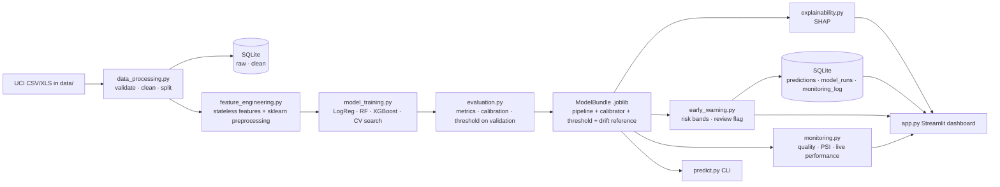
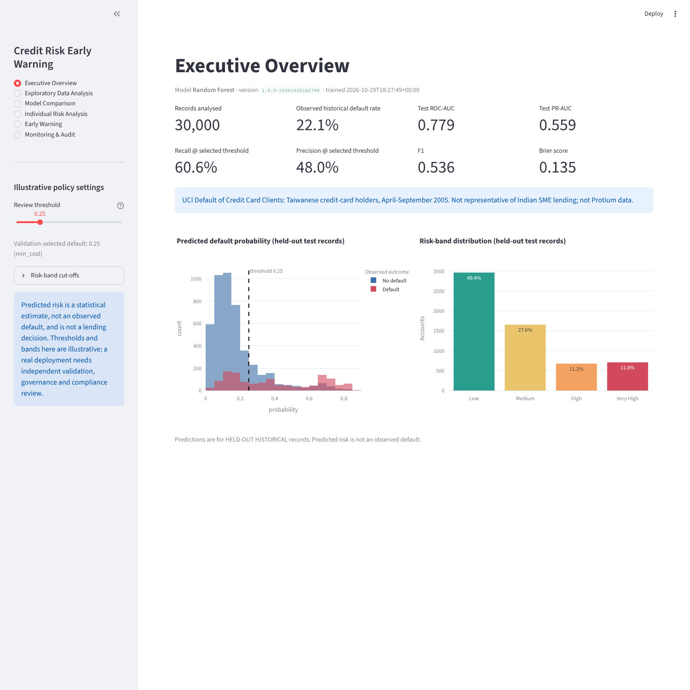
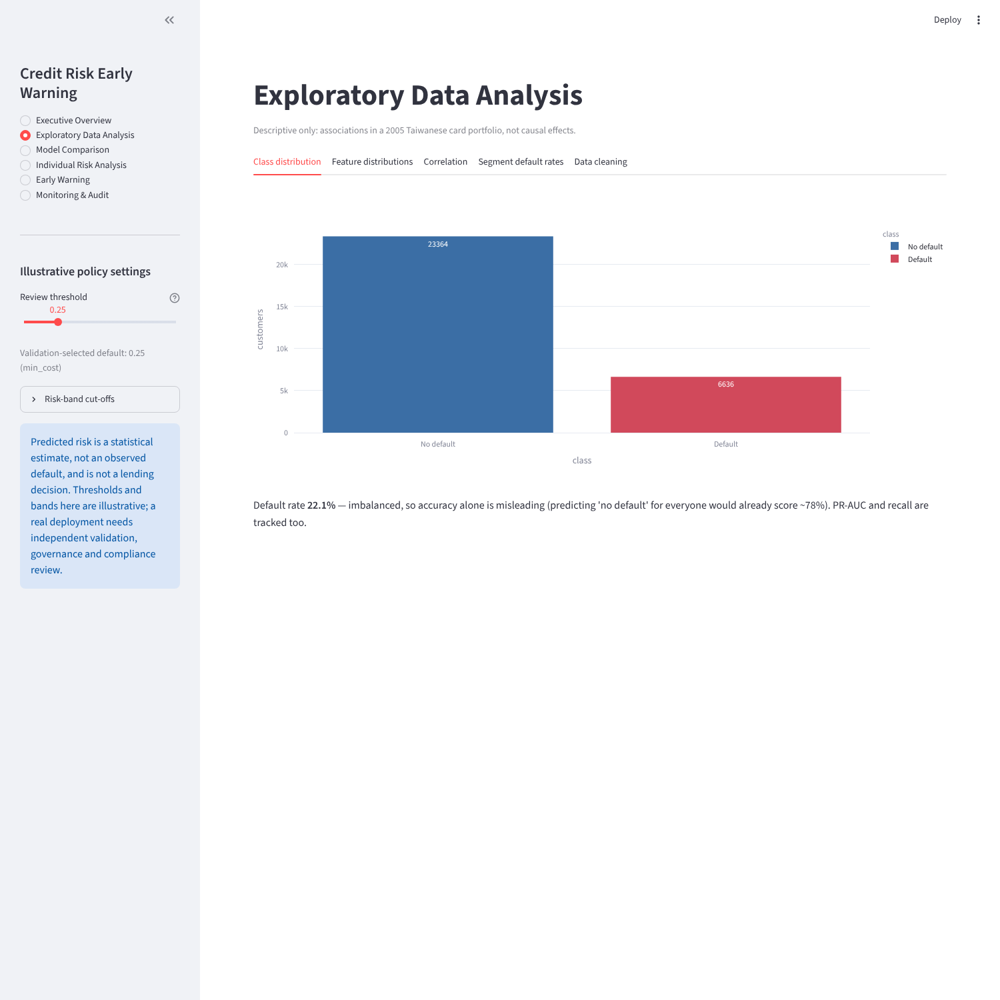
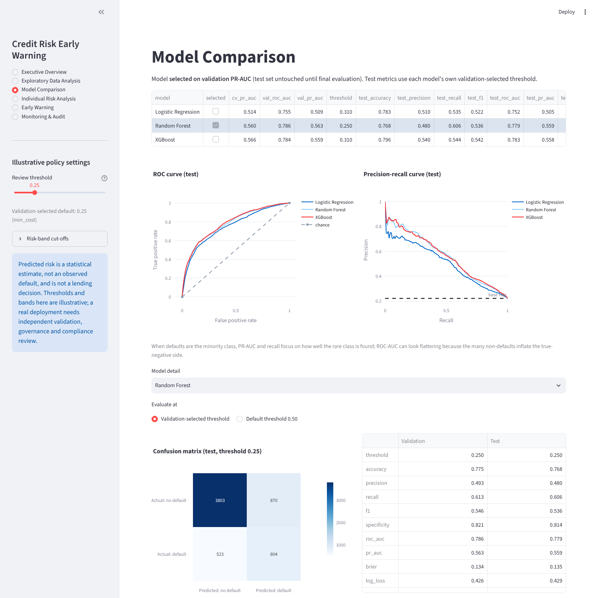
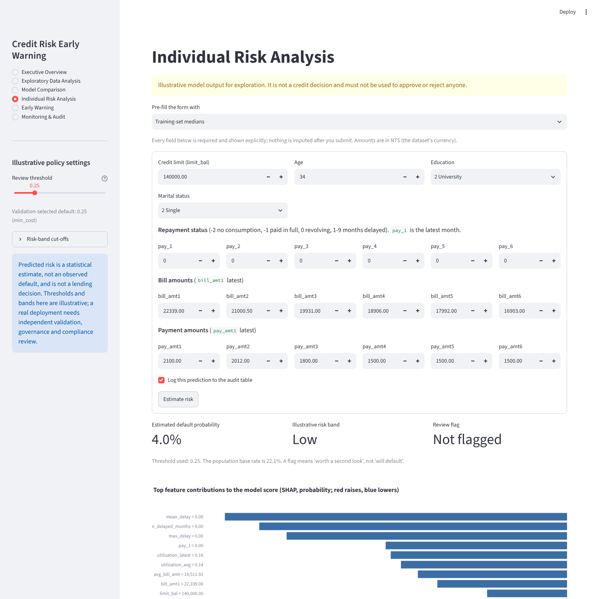
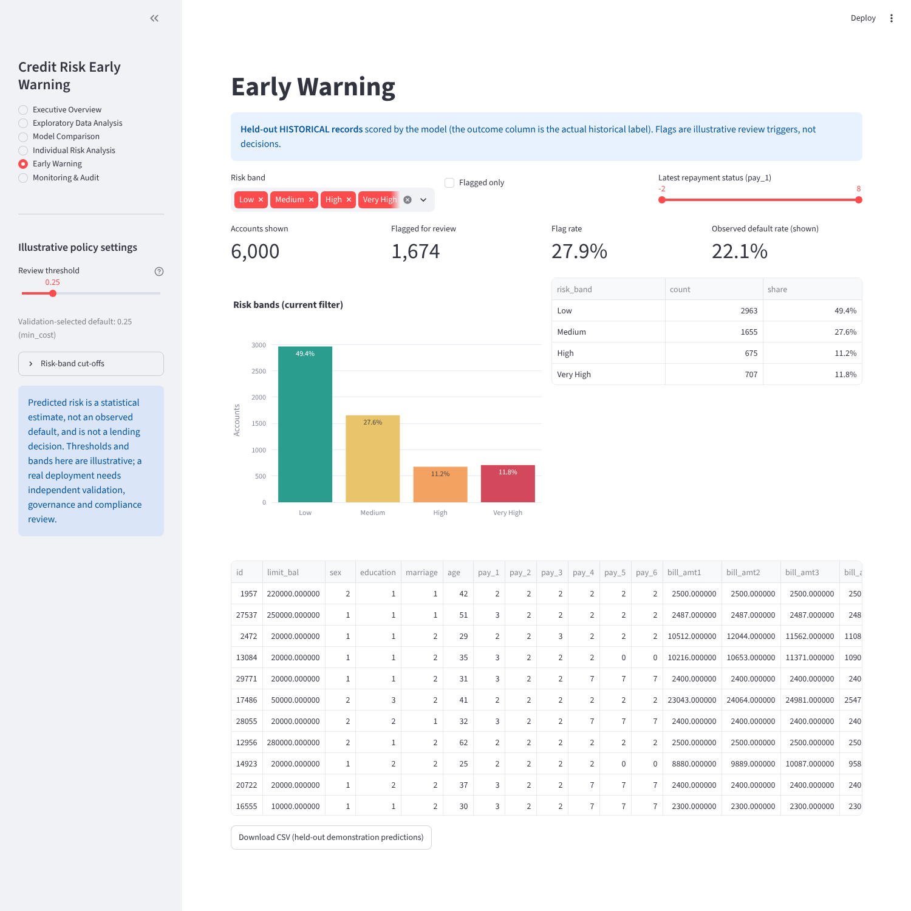
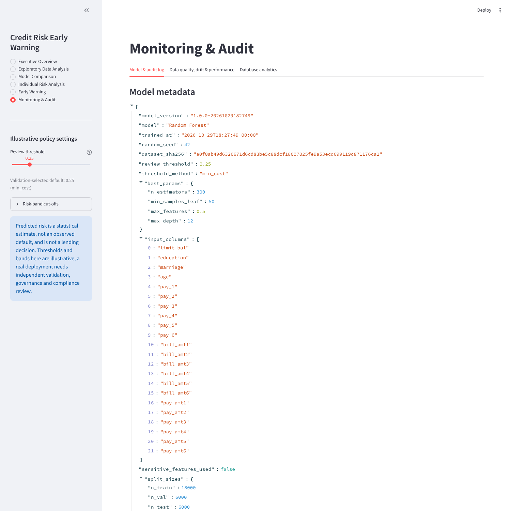

# Credit Risk Prediction & Early Warning System

An end-to-end, reproducible machine-learning project for a **lending-analytics** setting: data validation → SQL pipeline → three compared models (Logistic Regression, Random Forest, XGBoost) → calibrated probabilities and a validation-chosen threshold → SHAP explanations → a rule-based early-warning layer → monitoring/audit → an interactive Streamlit dashboard, with tests.

> **Important.** This is a portfolio/learning project built on a public **Taiwanese credit-card** dataset from 2005. It is **not** Indian SME lending data and **not** any lender's internal data (including Protium Finance). The thresholds and risk bands are **illustrative**, not a validated lending policy, and nothing here approves or rejects a loan. A real deployment would need independent model validation, governance, fairness review and compliance sign-off.

## Business problem

A lender wants to spot accounts that may become delinquent *before* it happens, so analysts can review them early. The model estimates the probability that a customer defaults on the next month's payment; the early-warning layer turns that probability into a review flag and a risk band that analysts can tune. Because only ~22% of customers default, the project tracks recall and PR-AUC rather than accuracy alone (a model that predicts "no default" for everybody is already ~78% accurate and useless).

## What is in the box

| Area | What it does |
|---|---|
| Data | Auto-detects and validates the dataset, standardizes columns, checks types/missing/duplicates/ranges/target, recodes undocumented category codes, stratified train/validation/test split **before** any fitting |
| SQL | SQLite via SQLAlchemy: raw, clean, predictions, model-run and monitoring tables; idempotent parameterized loads; reusable analytics queries |
| Models | Logistic Regression, Random Forest, XGBoost in scikit-learn pipelines; imbalance handling; CV hyper-parameter search scored on PR-AUC |
| Evaluation | Accuracy, precision, recall, F1, ROC-AUC, PR-AUC, Brier, confusion matrix, classification report, ROC/PR curves, calibration, threshold analysis (default 0.50 vs validation-selected) |
| Explainability | SHAP (TreeExplainer for RF/XGBoost, LinearExplainer for LR): global importance, summary plot, per-borrower explanation, additivity check |
| Early warning | Configurable review threshold and risk bands, counts/shares per band, CSV export |
| Monitoring | Data-quality checks, PSI drift, performance-when-labels-arrive, prediction audit log, model version/seed/dataset-hash metadata |
| Dashboard | Six Streamlit pages (overview, EDA, model comparison, individual risk, early warning, monitoring/audit) |
| Tests | 38 pytest tests (data, features, predictions, SHAP, drift, database) |

## Architecture



### Architectural decisions

* **One persisted `ModelBundle`** (pipeline, calibrator, threshold, feature names, drift reference, version, seed, dataset hash). Training, the CLI and the dashboard all call the same object, so train/inference transformations cannot diverge.
* **No leakage by construction.** Split first; imputers/scalers/encoders live inside the pipeline and are fit on the training split only; engineered features are stateless row-wise functions that never touch the target; the customer `id` is dropped by the `ColumnTransformer` (`remainder="drop"`).
* **Three roles for three splits.** *Train*: fit + cross-validated tuning. *Validation*: model selection (PR-AUC), Platt calibration, threshold choice. *Test*: reported once at the end.
* **Calibration.** Class weighting inflates raw probabilities, so a 2-parameter Platt scaler is fit on validation predictions. It is monotone, so ROC/PR-AUC and SHAP orderings are unchanged. Brier score before/after is reported.
* **Threshold = minimum illustrative cost on validation** (a missed defaulter costs 3× an unnecessary review; see `config.py`). It is recall-leaning by design and fully adjustable; a max-F1 option exists (`--threshold-method max_f1`). These costs are assumptions, not a real cost model.
* **`sex` is excluded from the model by default** (`config.USE_SENSITIVE_FEATURES = False`); it is kept for descriptive analysis only. Age and marital status remain available — a real fairness review would examine those too.
* **Dashboard reads pre-computed artifacts** from `outputs/` (and the model bundle), so it starts instantly and can be deployed without the raw dataset.
* **Undocumented category codes** (EDUCATION 0/5/6, MARRIAGE 0) are folded into "other", and the number of recoded rows is reported.

## Folder structure

```
credit-risk-early-warning/
├── app.py                  # Streamlit dashboard
├── train.py                # end-to-end training pipeline (CLI)
├── predict.py              # batch inference (CLI)
├── config.py               # paths, seeds, schema, illustrative policy settings
├── requirements.txt
├── src/
│   ├── data_processing.py  # find/load/validate/clean/split
│   ├── feature_engineering.py  # stateless features + preprocessing pipeline
│   ├── eda.py              # EDA artifacts + figures                      (added)
│   ├── database.py         # SQLAlchemy/SQLite layer
│   ├── model_training.py   # model specs, tuning, calibrator, ModelBundle
│   ├── evaluation.py       # metrics, threshold selection, plots
│   ├── explainability.py   # SHAP
│   ├── early_warning.py    # risk bands + review flags                     (added)
│   ├── inference.py        # input validation + prediction                 (added)
│   └── monitoring.py       # logging, data quality, PSI, live performance
├── sql/
│   ├── schema.sql          # table definitions
│   └── analytics.sql       # named, reusable queries
├── tests/                  # pytest suite (+ conftest.py with a synthetic fixture)
├── data/README.md          # dataset instructions (data files are git-ignored)
├── models/  outputs/       # generated artifacts (git-ignored)
└── docs/screenshots/       # dashboard screenshots
```

## Setup

Requires **Python 3.11+** (developed on 3.13).

**Linux / macOS**
```bash
python3 -m venv .venv
source .venv/bin/activate
pip install -r requirements.txt
```

**Windows (PowerShell / cmd)**
```bat
python -m venv .venv
.venv\Scripts\activate
pip install -r requirements.txt
```

### Dataset

Put the UCI file in `data/` (details in [`data/README.md`](data/README.md)). The zip you received already contains `data/UCI_Credit_Card.csv`. Otherwise download it from the [UCI repository](https://archive.ics.uci.edu/dataset/350/default+of+credit+card+clients) or its Kaggle mirror, or pass `--data-path`.

### Train, predict, dashboard, tests

```bash
python train.py                  # ~2-4 min on 2 CPU cores; writes models/ outputs/ and data/credit_risk.db
python train.py --fast           # tiny search for a quick smoke test
python train.py --data-path path/to/UCI_Credit_Card.csv --seed 7

python predict.py --input outputs/sample_input.csv --output outputs/predictions.csv
python predict.py --input my_borrowers.csv --threshold 0.30 --log-to-db

streamlit run app.py             # dashboard at http://localhost:8501

pytest -q                        # runs offline on a small synthetic fixture
```

`predict.py` needs the model's input columns (`limit_bal, education, marriage, age, pay_1…pay_6 (or PAY_0, PAY_2…), bill_amt1…6, pay_amt1…6`; an optional `id` is passed through). Column spellings are normalized. Missing or out-of-range values are **rejected with a clear message**; pass `--allow-missing` to impute with *training* medians/modes explicitly.

> The saved model is a pickle and depends on library versions. If loading fails after you change versions, just run `python train.py` again.

## SQL pipeline

`train.py` initializes `data/credit_risk.db` from `sql/schema.sql`, loads the data, and records the run. Loads are **idempotent** (re-running skips existing primary keys), parameterized, and schema-validated on startup.

| Table | Purpose |
|---|---|
| `raw_credit_clients` | Source rows as loaded (names standardized, values not recoded) so cleaning is auditable |
| `clean_credit_clients` | Validated/recoded rows + `split` (train/val/test) with CHECK constraints |
| `model_runs` | One row per training run: version, seed, dataset SHA-256, threshold, config, metrics, feature names |
| `predictions` | Audit log: model version, customer id, source, probability, threshold, flag, band, timestamp (+ input JSON for form entries) |
| `monitoring_log` | Drift (PSI), data-quality and performance observations over time |

Reusable queries live in `sql/analytics.sql` (`-- name:` blocks) and run via `database.run_query(engine, "name", params)`; they are also browsable in the dashboard (*Monitoring & Audit → Database analytics*): `portfolio_summary`, `split_summary`, `default_rate_by_education | marriage | age_band | limit_band | latest_repayment_status | months_delayed`, `risk_band_summary`, `flagged_accounts`, `recent_prediction_log`.

```python
from src import database as db
engine = db.get_engine()
print(db.run_query(engine, "default_rate_by_months_delayed"))
```

## Evaluation methodology

1. Stratified 60/20/20 train/validation/test split (seeded).
2. Per model: randomized CV search (3-fold, scored by PR-AUC) on **train only**; class imbalance via `class_weight` (LR, RF) or `scale_pos_weight` (XGBoost, computed from train).
3. On **validation**: Platt calibration → threshold table → threshold chosen by minimum illustrative cost → **model selection by validation PR-AUC** (not accuracy).
4. On **test**: every metric is computed once for all models at the default 0.50 threshold and at each model's validation-selected threshold. Nothing is hardcoded; numbers come from the run.
5. Why recall/PR-AUC: with ~22% defaulters, accuracy is dominated by the majority class and ROC-AUC is flattered by the many true negatives. PR-AUC and recall describe how well the rare, costly class is found and at what precision. A false negative (missed defaulter) is usually costlier than a false positive (extra review), hence the recall-leaning threshold — and the trade-off is visible in the threshold chart.

### Example results (one run, seed 42)

| Model | CV PR-AUC | Val PR-AUC | Threshold | Test recall | Test precision | Test F1 | Test ROC-AUC | Test PR-AUC | Test Brier |
|---|---|---|---|---|---|---|---|---|---|
| Logistic Regression | 0.514 | 0.509 | 0.31 | 0.535 | 0.510 | 0.522 | 0.752 | 0.505 | 0.142 |
| **Random Forest** ✔ selected | 0.560 | 0.563 | 0.25 | 0.606 | 0.480 | 0.536 | 0.779 | 0.559 | 0.135 |
| XGBoost | 0.566 | 0.559 | 0.31 | 0.544 | 0.540 | 0.542 | 0.783 | 0.558 | 0.135 |

Random Forest and XGBoost are within noise of each other; Random Forest was picked by the rule fixed in advance (highest *validation* PR-AUC), not by looking at the test set.

These come from `outputs/model_comparison.csv` of the run that produced the screenshots; your numbers can differ slightly with other library versions or seeds. Open the dashboard for the full evaluation.

## Early warning

`early_warning.py` converts probabilities into a review flag (`probability >= threshold`) and a band (Low / Medium / High / Very High by default, cut-offs 0.15 / 0.30 / 0.50). Both are adjustable in the dashboard sidebar and in `config.py`. A flag means "worth an analyst's second look", never "will default" and never an automatic decision. Held-out records are real historical rows with known outcomes; the monitoring page also offers a clearly labeled **synthetic** stress scenario to demonstrate drift detection.

## Explainability

SHAP explains the model that is actually deployed (verified by an additivity test: base value + Σ SHAP = model output). Units: log-odds of the raw score for XGBoost/LogReg, probability of the raw score for Random Forest. The displayed probability is a monotone recalibration of that score, so signs and rankings carry over. **SHAP shows how the model uses its inputs, not what causes default.**

## Screenshots

**Executive overview**



**Exploratory data analysis**



**Model comparison**



**Individual risk analysis with SHAP**



**Early warning**



**Monitoring & audit**



Static figures from the last training run are written to `outputs/figures/` (ROC/PR, calibration, threshold analysis, SHAP summary/waterfall, EDA).

## Deploying to Streamlit Community Cloud

1. Run `python train.py` locally, then force-add the small artifacts the dashboard reads (they are git-ignored by default):
   ```bash
   git add -f models/credit_risk_model.joblib outputs/*.csv outputs/*.json outputs/eda outputs/figures
   ```
   (the dataset itself and the SQLite DB are **not** needed and should stay out of git).
2. Push to GitHub, create an app on <https://share.streamlit.io>, point it at `app.py`, and pick a Python version matching the one you trained with so the pickle loads.
3. The app creates an empty SQLite database on first run; prediction logs on Community Cloud are ephemeral.

## Limitations and future work

* 2005 Taiwanese card data: different market, product and era from Indian SME lending; results do not transfer.
* Default is observed over a single next month; no time-based validation, vintage effects or macro features.
* Probability calibration is checked on one split; production use would need ongoing calibration monitoring.
* Cost ratio, bands and thresholds are illustrative; no fairness/bias audit beyond excluding `sex`; no reject-inference.
* PSI on small batches is noisy; drift thresholds are rules of thumb.
* Ideas: time-aware splits, monotonic constraints, conformal intervals, scheduled monitoring job, MLflow tracking, SME-specific features (GST/bureau/cash-flow) with proper data.

## Reproducibility notes

Seeds are fixed in `config.RANDOM_SEED`; the dataset SHA-256, model version, seed, training config and metrics are stored in the bundle, in `outputs/results.json` and in the `model_runs` table. `outputs/app.log` collects application logs.
